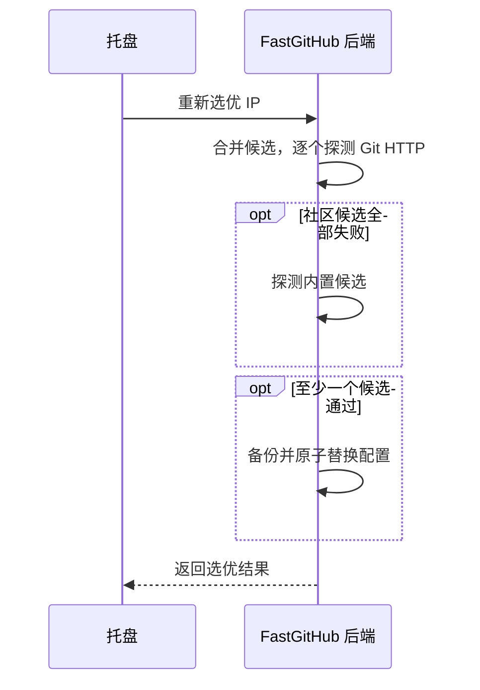

# fork 改动说明（相对上游 jsyzc2019/FastGithubOps.UI）

> 本 fork（[FluxForceDynamics/FastGithubOps.UI](https://github.com/FluxForceDynamics/FastGithubOps.UI)）在上游 v2.6.14 基础上，针对 `git clone` 链路的**成功率/稳定性**与「非管理员运行的**易用性**」做了 6 项增量改动。
> 全部改动聚焦「成功率、选对 IP、可观测」，不涉及突破跨境链路物理带宽。上游已实现的 IP 健康度反馈、成功 IP 记忆、候选池扩充等能力保持不变。

## 改动清单

| commit | 文件 | 改动 | 解决的根因 |
| --- | --- | --- | --- |
| `b21e4c0` | `FastGithub/appsettings/appsettings.github.json` | github.com `Timeout` 25s→90s（配置级） | 大 pack 传输被 25s 整体预算砍断 |
| `4a28e4c` | `FastGithub.Http/TelemetryPolicy.cs` | 新增 `IsGitSmartHttpRequest` + `GitTimeout=10min`，git 智能协议请求独立宽松超时 | 同上（源码级根治，替代 `b21e4c0` 的配置放宽） |
| `9274068` | `FastGithub.Configuration/DomainConfig.cs` | 新增 `IPAddresses[]` 列表字段（与单 `IPAddress` 兼容、列表优先） | 单 IP 无法固定多个候选 |
| `2e8ad45` | `FastGithub.Http/HttpClientHandler.cs` | 建连候选支持固定 IP 列表按序回退 | 同上 |
| `39f8028` | `FastGithub.UI/Program.cs` | 启动时检测管理员权限，非管理员弹窗警告 | 非管理员静默降级、用户无感知 |
| `190d9c7` | `FastGithub.UI/MainWindow.xaml.cs` | 非管理员托盘气泡二次提醒 | 同上 |

## 一、git clone 慢/失败的根因与修复

### 根因（实测）

用 `curl --resolve` 直连 GitHub 官方 IP，对 `github.com` 做「网页首页」与「git 协议端点（`/info/refs?service=git-upload-pack`）」对比测试：

| IP | 网页首页 | git 协议端点 | 吞吐 |
| --- | --- | --- | --- |
| `57.155.223.240` | 200（0.31s） | **000 连不上** | — |
| `20.200.245.244 / 247` | 400 | **000 连不上** | — |
| `20.6.7.17` | 200 | 200 | **16.7 KB/s** ✅ |
| `140.82.113.4`（传统段） | 200 | 200 | 4.4 KB/s |

两层根因：

1. **探测指标不足**：FastGitHub 的 IP 探测只做 TCP 握手（`IPAddressService.GetAddressElapsedAsync`，注释明确为防风控放弃 TLS），但「TCP/网页通 ≠ git 协议通」。上表中 `57.155.223.240` 建连快却被排到候选首位，git clone 一连上就卡死。注意：该 IP 经 `gh api meta` 核实为 GitHub **官方**段，不是污染 IP。
2. **整体预算砍断大 pack**：`github.com.Timeout=25s` 是「建连+传输+下载」的整体预算，大 pack 在跨境链路上需数分钟，25s 一到被 `CancellationToken` 砍断 → `unexpected disconnect while reading sideband packet` / `invalid index-pack output`。

### 修复

- **源码级（`4a28e4c`）**：`TelemetryPolicy.LimitTimeout` 对 git 智能协议请求（路径后缀 `info/refs` / `git-upload-pack` / `git-receive-pack`）单独放宽到 10 分钟；普通请求仍按域名默认预算快速失败。配置级 `b21e4c0` 的 90s 因此被取代（运行实例可回退为默认 25s，由代码自动放宽 git 请求）。
- **配置级（运行实例）**：给 `github.com` 加 `"IPAddress": "20.6.7.17"`（实测 git 协议吞吐最优的官方 IP），`DomainConfig.IPAddress` 建连时优先尝试，失败后再尝试动态解析。

## 二、固定 IP 列表（`9274068` + `2e8ad45`）

固定地址由 `IPAddresses` 按配置顺序提供，也兼容旧的单项 `IPAddress`。新连接优先拨固定地址。固定候选无法连接时，在同一个 10 秒建连预算内尝试去重后的动态地址，三条固定地址失败后仍给动态池留一次机会。解析阶段只占剩余时限的一部分，回退使用时限内已取得的地址。

`--SelfTest` 通过模拟拨号覆盖固定地址成功时直接返回，以及前三条固定地址失败后连接动态地址。

### 托盘重新选优

托盘「重新选优IP」调用本机 C# 后端。后端合并四个社区 hosts 源的 `github.com` 地址，沿用域名的 TLS SNI 设置和证书链校验，逐个下载 Git 智能 HTTP 的 `info/refs` 响应。社区候选全部失败时会尝试尚未测过的内置 IP。选优成功后，按下载速率将前 3 个写入 `IPAddresses`，并备份替换前的 `appsettings.github.json`。

实机验收时，点击托盘菜单并核对提示、日志和 `IPAddresses`，再通过 FastGitHub 运行真实 `git clone`。`info/refs` 的下载速率用于选 IP，完整 clone 的稳定性仍需实测。

## 三、UI 非管理员警告（`39f8028` + `190d9c7`）

`app.manifest` 已声明 `requireAdministrator`（正常双击一定提权），但 `start`/脚本/启动器直拉可绕过。此前 `Program.cs` 无运行时检测，后端在 WinDivert 失败时静默降级为 `127.0.0.1:38457` 正向代理，用户无感知。

修复：`Program.IsAdministrator()` 检测（`WindowsIdentity`/`WindowsPrincipal`，注意 UI 工程为 `net45`，类型在 `System.Security.Principal` 命名空间而非 .NET Core 的 `.Windows`）；非管理员时弹窗「继续降级/退出」（默认退出）+ 托盘气泡二次提醒。

## 验证结果（2026-11-20 实测）

| 指标 | 优化前 | 优化后 |
| --- | --- | --- |
| `git ls-remote` | 21s 超时失败 | 1.28s 成功 |
| `info/refs` 首包 | 6.3s | 651ms / 328ms |
| `git-upload-pack`（小请求） | 24.9s 险超时 | 357ms |
| clone 结果 | 反复失败 | 连续 2 次成功（exit 0） |
| clone 耗时 | 失败 | 9.3s / 10s |
| 吞吐 | ~20 KB/s | ~6.4 MB/s（≈320 倍） |

编译：后端 `.NET 10`（6 个 warning 均为原有代码）、UI `net45`（0 警告 0 错误）。

## 运行前提

- 透明拦截依赖 **WinDivert 内核驱动**，必须以**管理员身份**运行；普通身份会降级为 `38457` 正向代理（本 fork 已加 UI 警告）。
- 不要在沙箱/受限会话中启动（WinDivert 抓不到真实 DNS 流量，且 WPF UI 无法维持会连带核心进程退出）。
- 确认拦截生效：管理员启动后 `Resolve-DnsName github.com -Type A` 应返回 `127.0.0.1`。

## 相关 Issue（上游）

- [Issue #1：git clone 慢/失败的根因分析与 5 项优化建议](https://github.com/jsyzc2019/FastGithubOps.UI/issues/1)
- [Issue #2：非管理员运行时在 UI 层给出明确警告](https://github.com/jsyzc2019/FastGithubOps.UI/issues/2)
