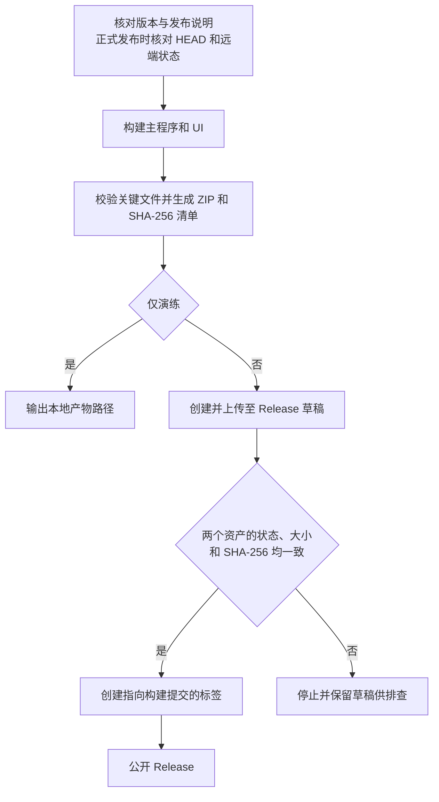

# 本地构建与 GitHub Release 发布

| 场景 | 入口 |
| --- | --- |
| 在 GitHub Actions 中完成构建与发布 | [Create Release](../.github/workflows/release.yml) 的 `workflow_dispatch` |
| 在 Windows 上演练打包，或在 CI 发布受阻时从本机发布 | [`release-local.ps1`](../release-local.ps1) |

`v2.6.15` 曾通过本地构建和 GitHub API 发布。当时 [Create Release](https://github.com/FluxForceDynamics/FastGithubOps.UI/actions/runs/44699997924) 在推送标签时返回 403。CI 的 `check-and-tag` 和 `create-github-release` 两个任务都需要 `contents: write`，实际权限还受仓库策略和标签规则影响。更新工作流文件本身时，OAuth 或经典 PAT 还需要 `workflow` scope。［[GitHub Actions 权限说明](https://docs.github.com/en/actions/tutorials/authenticate-with-github_token#modifying-the-permissions-for-the-github_token)］

## 准备版本

1. 将 [`Directory.Build.props`](../Directory.Build.props) 的 `<Version>` 更新为本次版本。补丁版本递增末位。
2. 新增对应的 [`release-notes/vX.Y.Z.md`](../release-notes/README.md)，填写变更、下载和校验说明。
3. 正式发布前把版本提交推送到目标仓库，并确认本地 HEAD 指向该提交、工作区干净。使用未被标签或 Release 占用的版本号。

### 从 PR 合并提交本地发布

1. 将版本号、对应发布说明和使用文档放入 PR，在 Windows 上用 `-NoPublish` 演练打包。
2. 需要全程本地验证时，在 PR 最后一次提交和最终合并提交的消息中加入 `[skip ci]`。这会跳过本仓库由 `push` 和 `pull_request` 触发的构建。 [GitHub 跳过工作流说明](https://docs.github.com/en/actions/how-tos/manage-workflow-runs/skip-workflow-runs)
3. 合并后同步 `main`，以远端 `main` 的合并提交作为 `-Target` 运行本地脚本。脚本从该提交重新构建并上传 GitHub Release 资产。

## 运行脚本

使用 Windows PowerShell 5.1 或 PowerShell 7，准备可构建 `net10.0` 的 .NET SDK（与 CI 一致时使用 .NET 10 SDK）和 UI 所需的 .NET Framework 4.5 引用程序集。依赖还原使用脚本生成的 NuGet.org 配置。正式发布还需要 Git 和已登录的 GitHub CLI，凭据须能在目标仓库创建标签和 Release。

```powershell
[xml]$props = Get-Content -LiteralPath .\Directory.Build.props -Raw -Encoding UTF8
$version = "v$($props.SelectSingleNode('/Project/PropertyGroup/Version').InnerText.Trim())"
$repo = 'FluxForceDynamics/FastGithubOps.UI'

# 演练当前源码的构建、校验和打包
.\release-local.ps1 -Version $version -NoPublish

# 完成所列准备工作后正式发布
.\release-local.ps1 -Version $version

# 正式发布的另一种调用方式，显式指定仓库、提交和新输出目录
.\release-local.ps1 -Version $version -Repo $repo `
    -Target (git rev-parse HEAD) -OutDir "D:\release\fastgithub-$version"
```

- `-NoPublish` 允许对工作区改动演练，只运行本地构建和打包。构建还原依赖时仍可能访问 NuGet.org。
- `-Repo` 默认为 `FluxForceDynamics/FastGithubOps.UI`。`-Target` 在正式发布时默认取当前 HEAD，显式传入时须使用同一个完整 SHA。
- 默认每次在系统临时目录下创建独立的 `fastgithub-release-<版本>-<运行标识>` 目录。指定的 `-OutDir` 须是尚不存在的路径。构建中间文件、发布文件和资产均保存在输出目录内。



## 发布产物与校验

- 主程序为 `net10.0` 的 win-x64 自包含单文件。YARP 和 ASP.NET Core 使用运行时反射，因此关闭裁剪。
- 托盘 UI 面向 `net45`，运行时在同目录查找 `fastgithub.exe`。两项目输出到同一目录，ZIP 根目录须包含 `fastgithub.exe`、`FastGithub.UI.exe`、`FastGithub.UI.exe.config` 和 `appsettings.json`。
- 主程序在运行时单独启动 `dnscrypt-proxy/dnscrypt-proxy.exe`，并读取同目录的 `dnscrypt-proxy.toml`。ZIP 须保留这两个文件及相对路径。
- 打包时排除 `cacert/` 和 `logs/`。应用启动时会生成本机 CA，`cacert/` 可能包含 CA 私钥。
- `fastgithub-win-x64.sha256` 记录两个 EXE 的 SHA-256，格式为 `<hash>  <文件名>`，两者之间有两个空格。
- 正式发布时，脚本按草稿 ID 回读 `fastgithub-win-x64.zip` 和 `fastgithub-win-x64.sha256` 的上传状态、大小和 `digest`。两项资产均匹配后，脚本创建标签并公开草稿。GitHub 会拒绝创建已存在的引用。［[Release 资产接口](https://docs.github.com/en/rest/releases/assets)］［[Git 引用接口](https://docs.github.com/en/rest/git/refs#create-a-reference)］

### 公开后复核

在本地发布公开后，使用上文设置的 `$repo` 和 `$version` 检查 GitHub 的最新正式版、轻量标签和公开资产。

```powershell
gh api "repos/$repo/releases/latest" --jq '{tag_name,html_url,draft,prerelease}'
gh api "repos/$repo/git/ref/tags/$version" --jq '.object.sha'
gh api "repos/$repo/releases/tags/$version" --jq '.assets[] | {name,state,size,digest}'
```

检查最新正式版是否为 `$version`、标签 SHA 是否等于构建提交，以及两个资产的 `size` 与 `digest` 是否匹配本地同名文件。如果需要验证下载链路，下载资产后用 `Get-FileHash -Algorithm SHA256` 对照 API 的 `digest`。ZIP 内两个 EXE 的哈希记录在随附的 `.sha256` 文件中。 [GitHub Release 接口](https://docs.github.com/en/rest/releases/releases#get-the-latest-release)

## 排查与重试

| 现象 | 处理 |
| --- | --- |
| CI 推送标签时返回 403 | 检查 CI 的 `GITHUB_TOKEN` 权限和标签规则，或在 Windows 上使用本地发布流程 |
| 本地 GitHub CLI 返回 401 或 403 | 用 `gh auth status --hostname github.com` 查看登录账号，检查 `GH_TOKEN` 是否覆盖登录凭据，再用 `gh api "repos/$repo" --jq '.permissions.push'` 核对目标仓库写权限 |
| 目标提交无法访问，或 `Target` 与 HEAD 不一致 | 检出并推送待发布提交，使用该提交的完整 SHA |
| 输出路径已存在 | 选择新的输出路径，或省略 `-OutDir` 让脚本生成独立目录 |
| NuGet 还原失败或出现 `End of Central Directory` | 检查 NuGet.org 连通性和对应的本地缓存包。CI 也切换到了 NuGet.org |
| 资产缺失、大小或摘要不符 | 在 Releases 页面按脚本输出的草稿 ID 排查，核对本地 ZIP 和 SHA-256 清单 |

草稿创建后发生中断时，先检查远端草稿、已公开的 Release 和同名标签。确认需要重跑时，清理本次留下的草稿和标签，再使用新的输出目录运行。若 GitHub 已公开 Release，核对该 Release 的资产。

历史发布记录见 [v2.6.15](https://github.com/FluxForceDynamics/FastGithubOps.UI/releases/tag/v2.6.15)。该 Release 的 ZIP 为 50,114,579 字节，并随附 SHA-256 清单。
